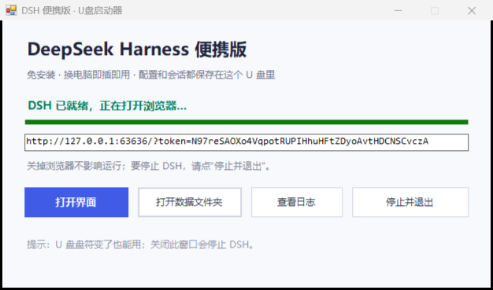

# DeepSeek Harness 便携版

把 [DeepSeek Harness](https://github.com/deepseek-ai/deepseek-harness)（DSH）装进 U 盘的免安装启动器：
自带 Node.js 运行时，不写注册表，配置、登录状态和会话记录随身携带。
插到任意 **64 位 Windows 10 / 11** 电脑上，双击就能用。

> 本仓库只包含**启动器源码、构建脚本和文档**。
> 约 242 MB 的成品包请到 [Releases](../../releases/latest) 下载。



## 特性

- **免安装**：自带 Node.js 24 与 DSH，目标电脑不需要装 Node、npm 或 DSH。
- **即插即用**：自动定位 U 盘盘符，盘符从 E 变成 F 也不受影响。
- **快速启动**：首次把运行环境解压到本机缓存，之后同一台电脑几秒启动。
- **数据便携**：登录状态、配置、会话记录都保存在 U 盘的 `home\.dsh`，换电脑免登录。
- **省心**：自动挑空闲端口、自动打开带令牌的界面地址、一键停止 DSH。
- **健壮**：缓存目录自动回退（`%LOCALAPPDATA%` → `%TEMP%` → 程序目录），
  被沙箱或杀毒软件拦截时不会只报一句“访问被拒绝”。

## 下载与使用

1. 打开 [Releases](../../releases/latest)，下载 `DeepSeek-Harness-Portable-v1.0.0-win-x64.zip`。
2. 解压到 U 盘或任意文件夹。
3. 双击 `DSH-Portable.exe`。
4. 首次启动会解压运行环境（1–3 分钟，窗口内有进度），随后自动打开浏览器。
5. 用你自己的 DeepSeek 账号登录即可；同一台电脑以后启动只要几秒。

> `DSH-Portable.exe` 没有数字签名，SmartScreen / 杀毒软件可能拦截，选择“仍要运行”即可；
> 也可以改用 `启动DSH-命令行版.cmd`。

## 成品包结构

```
DSH-Portable.exe        启动器（C# WinForms）
启动DSH-命令行版.cmd     备用启动方式
payload\app.zip         DSH 程序本体（约 206 MB）
payload\runtime.zip     Node.js 24 运行时（约 37 MB）
home\.dsh\              登录状态、配置、会话记录（你的数据）
home\.agents\           共享 Agent 配置
workspace\              默认工作目录
logs\                   启动日志
licenses\               第三方许可证
```

本机缓存位于 `%LOCALAPPDATA%\DSHP`（约 700 MB），删除后下次启动会重新解压。

## 工作原理

启动器实际执行的操作等价于：

```bat
set DSH_HOME=<U盘>\home\.dsh
set DSH_AGENTS_HOME=<U盘>\home\.agents
set PATH=%LOCALAPPDATA%\DSHP\r;%PATH%
cd /d <U盘>\workspace
%LOCALAPPDATA%\DSHP\r\node.exe %LOCALAPPDATA%\DSHP\a\node_modules\@deepseek-ai\dsh\lib\bin.js ^
    web --port 0 --host 127.0.0.1 --no-open
```

- `payload\*.zip` 首次解压到本机缓存，用 zip 的大小 + 修改时间作为版本戳，更新 zip 后自动重新解压。
- `--port 0` 由系统选择空闲端口，避免和本机已运行的 DSH 冲突。
- `--no-open` 关闭 DSH 自带的浏览器打开逻辑；启动器解析它打印的带令牌 URL 后再打开。
- `DSH_HOME` 把全部用户数据重定向到 U 盘，实现真正的便携。

## 从源码构建

需要：

- Windows x64
- .NET Framework 4.x（`C:\Windows\Microsoft.NET\Framework64\v4.0.30319\csc.exe`）
- Node.js 24（用于 `npm install` 和作为便携运行时来源）
- 可选：7-Zip（更快地生成 payload zip；没有则用 .NET 自带压缩）

```powershell
# 在仓库根目录
powershell -ExecutionPolicy Bypass -File .\build\build.ps1 `
    -NodeDir "D:\node.js" `
    -DshVersion "0.2.1-rc.2" `
    -OutDir ".\dist"
```

脚本会：

1. `npm install @deepseek-ai/dsh@<version>` 到临时目录；
2. 生成 `payload\app.zip` 与 `payload\runtime.zip`；
3. 用 `csc` 编译 `src\Launcher.cs`；
4. 组装出可直接分发的 `dist\DSH-Portable\`。

## 已知限制

- 仅支持 64 位 Windows 10 / 11；ARM 版 Windows 不能直接运行（Node 为 x64）。
- 首次启动需要目标电脑系统盘有约 800 MB 空闲空间。
- DSH 的终端类工具需要目标电脑装有 PowerShell 7（`pwsh`），建议再装 Git。
- 启动器无数字签名。
- 本项目是**非官方**打包工具，与 DeepSeek 官方无关；DSH 本身的问题请反馈给上游项目。

## 许可证

- 本仓库的启动器代码：MIT，见 [LICENSE](LICENSE)。
- 成品包内包含 DeepSeek Harness（MIT）和 Node.js（MIT）等第三方组件，
  其许可证随包放在 `licenses\`，详见 [THIRD-PARTY-NOTICES.md](THIRD-PARTY-NOTICES.md)。
